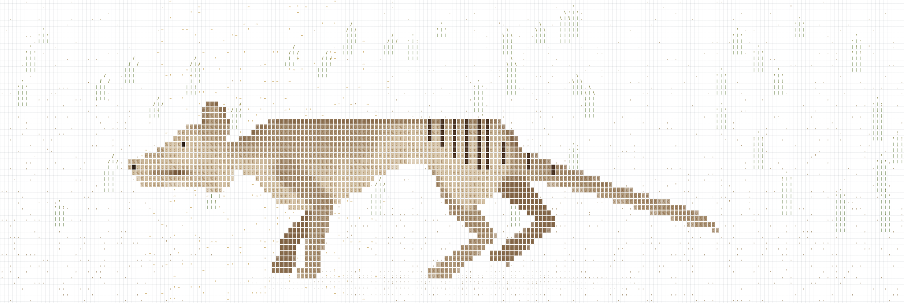
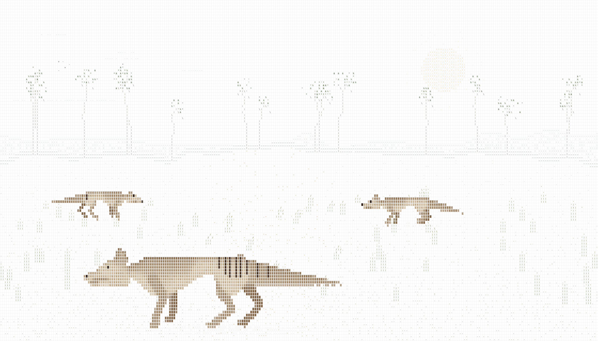
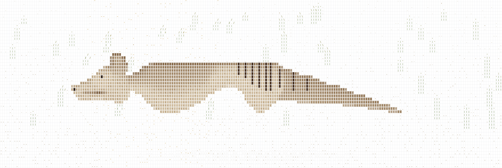

# AsciiTasmanianTigers

The last known thylacine died in Hobart on 7 September 1936. This page brings a few of them back to walk through a eucalypt grassland, drawn in ASCII cells.

**Live page:** https://codedrichy.github.io/AsciiTasmanianTigers/



## How it is drawn

The body is not traced from a photo. It is built from a proportion sheet measured off about 25 reference images: live photos, museum mounts and skeletons. `pipeline/build_body.py` turns that sheet into a tone grid and writes `roto-data.js`. The page renders the grid as 2x2-sampled cells, with half-covered edge cells drawn at partial strength so slopes read as slopes.

The legs are separate. Each one is a two-bone IK chain with a foot, driven by a lateral-sequence walk whose phase comes from distance travelled. Paws stay pinned while they bear weight.

The tail swings from its root in time with the gait and the tip lags a little. Thylacine tails were stiff, so it never wags.

The scene runs on one wind. Gust fronts roll across the field every ten seconds or so. The grass bends, a sheen crosses the dry ground, canopies rustle and seed drifts with it.

Clicking the grass sends a flare through it that spreads and fades, the way ascii-sharks does with water. Any thylacine nearby bolts. The pointer and the animals' feet leave fainter trails in the same field.



## How it got better

Every round went to three critics working in parallel: an illustrator, a pixel-art director and a zoologist. A fix went in only when two of them asked for it. They disagreed often. One wanted shorter legs, another longer.

Absolute scores stalled around 5 to 6 for six rounds. Switching the critics to score each round against the previous round's images broke the plateau. Round 24 averaged 7.1 out of 10. Round 31 averaged 8.1, after the tail became a shape drawn fresh each frame.

Things that looked right and were not:

- Any lean on a stripe snaps into a staircase of cells. Stripes are vertical.
- A gentle rise in the back snaps to a whole row and reads as a hump. The back is level.
- Two-cell stripe tops touch the next stripe and spell letters. Stripes are one cell wide.



## Run it

Open `index.html` through any static server:

```
python -m http.server 5199
```

Rebuild the body after editing the sheet:

```
python pipeline/build_body.py
```

The capture scripts in `tools/` expect the page at `http://127.0.0.1:5199/index.html` and need Playwright.

## Credit

The cell style comes from [stackedlol/ascii-sharks](https://github.com/stackedlol/ascii-sharks) (MIT).

## License

MIT. See [LICENSE](LICENSE).
